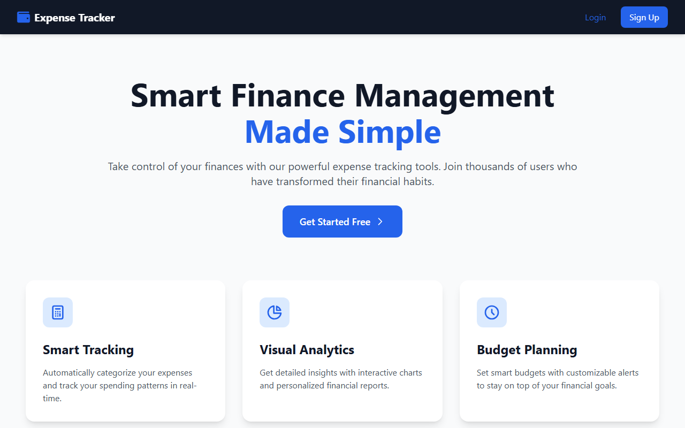

Expense Tracker App
===================

Track personal expenses, filter them by date and category, and get spending insights from Google Gemini.

**Live demo:** [expense-tracker-app-manthanank.vercel.app](https://expense-tracker-app-manthanank.vercel.app)



This is a full-stack expense tracker application built with a **Node.js + Express** backend and an **Angular** frontend. It allows users to sign up, log in, add, edit, delete, and filter expenses by date and category. The app also includes **AI-powered financial insights** using Google's Gemini API.

Table of Contents
-----------------

- [Features](#features)
- [Technologies Used](#technologies-used)
- [Project Structure](#project-structure)
- [Run locally](#run-locally)
- [Prerequisites](#prerequisites)
- [Installation](#installation)
- [Running the Application](#running-the-application)
- [API Endpoints](#api-endpoints)
- [Usage](#usage)
- [Deployment](#deployment)
- [License](#license)
- [Contact](#contact)

Features
--------

- **User authentication with JWT**
- **Responsive landing page**
- **Add, edit, delete, and view expenses**
- **Filter expenses** by date range and category
- **Total expense calculations** for:
  - Past week
  - Last month
  - Last 3 months
  - Last 6 months
  - Custom date range
- **AI-powered expense analysis and personalized financial insights** using Google Gemini API
- **Smart spending recommendations** and budget health assessment
- **Expense visualization** with charts and graphs
- **Forgot and reset password** functionality
- **Visitor count tracking**
- **Privacy policy and terms of service** pages
- **Responsive design** using Tailwind CSS

Technologies Used
-----------------

Backend
-------

- Node.js
- Express.js
- MongoDB & Mongoose
- JWT for authentication
- Nodemailer for email functionality
- Google Generative AI (Gemini) for financial insights
- Swagger for API documentation
- Express Rate Limiter & Helmet for security

Frontend
--------

- Angular 19
- Tailwind CSS for styling
- NGX Charts for data visualization
- Font Awesome icons

Project Structure
-----------------

```text
expense-tracker-app/
  backend/         # Node.js + Express API
  src/             # Angular frontend source
  public/          # Static assets
```

Key backend folders:

- `backend/controllers` – request handlers for auth, expenses, admin, and insights
- `backend/models` – Mongoose models (`user`, `expense`, etc.)
- `backend/routes` – Express routes (`/auth`, `/expenses`, `/insights`, `/admin`)
- `backend/services` – email and Gemini AI integration

Key frontend areas:

- `src/app/auth` – login, signup, forgot/reset password, social auth
- `src/app/components` – dashboard, home, insights
- `src/app/expenses` – add, edit, list expenses
- `src/app/core` – services, guards, interceptors, models

Run locally
-----------

```sh
git clone https://github.com/manthanank/expense-tracker-app.git
cd expense-tracker-app

# backend (needs backend/.env, see Installation below)
cd backend
npm install
npm start          # http://localhost:5000

# frontend, in a second terminal from the repo root
npm ci
npm start          # http://localhost:4200
```

`npm run build` writes the production frontend build to `dist/`.

Prerequisites
-------------

- Node.js 20 or later (CI uses Node 22)
- Angular CLI (v19.x or later)
- MongoDB (local instance or cloud, e.g. MongoDB Atlas)
- Google Gemini API key
- A Gmail account (or SMTP credentials) for password reset emails

Installation
------------

1. **Clone the repository**

   ```sh
   git clone https://github.com/manthanank/expense-tracker-app.git
   cd expense-tracker-app
   ```

2. **Backend setup**

   ```sh
   cd backend
   npm install
   ```

   Create a `.env` file inside the `backend` directory:

   ```bash
   PORT=5000
   MONGO_URI=your_mongodb_connection_string
   TOKEN_SECRET=your_jwt_secret
   EMAIL_USER=your-email@gmail.com
   EMAIL_PASS=your-email-password-or-app-password
   GEMINI_API_KEY=your_gemini_api_key
   BACKEND_URL=http://localhost:5000
   NODE_ENV=development
   GOOGLE_CLIENT_ID=your_google_client_id
   GOOGLE_CLIENT_SECRET=your_google_client_secret
   GITHUB_CLIENT_ID=your_github_client_id
   GITHUB_CLIENT_SECRET=your_github_client_secret
   ```

   Start the backend server:

   ```sh
   npm start
   ```

   By default the backend runs at `http://localhost:5000`.

3. **Frontend setup**

   From the project root, install frontend dependencies:

   ```sh
   npm install
   ```

   Start the Angular development server:

   ```sh
   ng serve
   ```

   The frontend will be available at `http://localhost:4200`.

Running the Application
-----------------------

- **Backend**: `http://localhost:5000`
- **Frontend**: `http://localhost:4200`
- **API docs (Swagger)**: `http://localhost:5000/api-docs`

Make sure the backend is running before using the frontend so that authentication and expense APIs work correctly.

API Endpoints
-------------

Auth
----

- **POST `/api/auth/signup`** – Create a new user
- **POST `/api/auth/login`** – Authenticate a user and return a JWT
- **POST `/api/auth/forgot-password`** – Send password reset email
- **POST `/api/auth/reset-password/:token`** – Reset user password

Expenses
--------

- **GET `/api/expenses`** – Get all expenses for the logged-in user
- **GET `/api/expenses/:id`** – Get a single expense by ID
- **POST `/api/expenses`** – Add a new expense
- **PUT `/api/expenses/:id`** – Update an existing expense
- **DELETE `/api/expenses/:id`** – Delete an expense

Insights (AI)
-------------

- **GET `/api/insights/ai`** – Get AI-generated insights for expenses with optional filters
  - Query parameters:
    - `startDate` – Filter expenses from this date
    - `endDate` – Filter expenses up to this date
    - `category` – Filter by expense category

Usage
-----

1. **Sign Up** – Create a new account from the sign-up page.
2. **Log In** – Log in with your credentials to access the dashboard.
3. **Forgot Password** – Use the "Forgot password" link if you need to reset your password.
4. **Reset Password** – Follow the link in the email to choose a new password.
5. **Add Expense** – Add expenses with amount, category, date, and description.
6. **View Expenses** – Browse all your expenses and use filters for date range and category.
7. **Edit Expense** – Click an expense to update its details.
8. **Delete Expense** – Remove an expense permanently.
9. **Get AI Insights** – Open the insights section to see analysis of your spending patterns, top categories, anomalies, and saving suggestions.
10. **View Charts** – Use the charts to visually explore your spending trends over time.

Deployment
----------

The application is deployed on Vercel at:

- Frontend: [https://expense-tracker-app-manthanank.vercel.app/](https://expense-tracker-app-manthanank.vercel.app/)

Backend can be deployed separately (e.g., on services like Render, Railway, or any Node-compatible host) with the same environment variables as in local `.env`.

License
-------

This project is licensed under the **MIT License**. See the [LICENSE](LICENSE) file for details.

Contact
-------

For questions or feedback:

- Email: [manthan.ank@gmail.com](mailto:manthan.ank@gmail.com)
- GitHub: [manthanank](https://github.com/manthanank)
